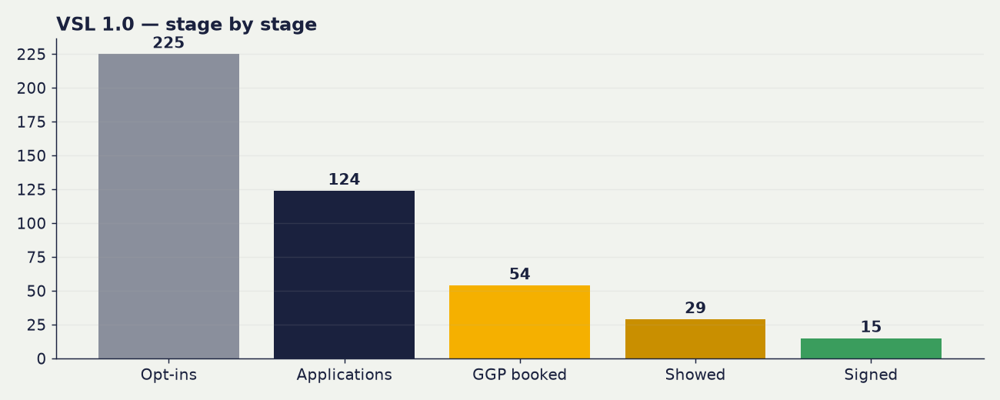
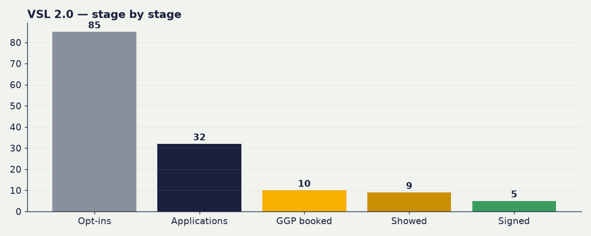
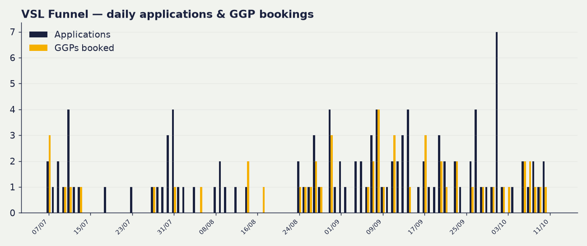
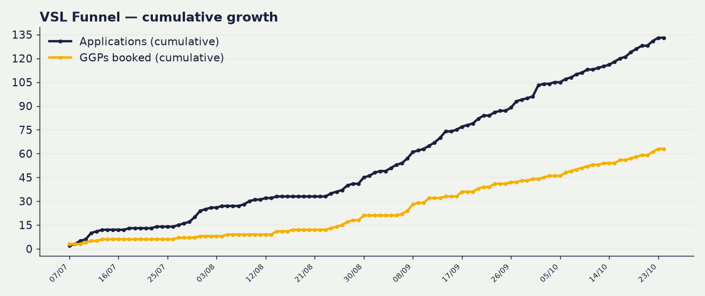

# 📈 VSL Funnel Dashboard

_Signups from Stripe (live API). Show-ups from the SBC team Tick Sheet. Spend from Meta. Updated 11 Oct 2026, 03:22 BST, rebuilds nightly._

## 🎯 The headline — both funnels combined

| | |
|---|---|
| **Blended CPA** | **£559** |
| Total spend | **£10,064.76** |
| Total signups | **18** |
| Who signed | Adam Luke, Adam Timpson, Alexandru Mardari, C Beech, Conor, Daniel  Steer, Georgia, Harry, Joe Gray-Misiuk, Kirstie Hall, Lily  Colmer, MR B CAMPBELL, Matt, Mohit, Musa Rahat, Ross gibbins, Tarik Merrett, Zeeshan Ahmed |

> £10,065 spent → 18 signed = **£559 blended cost per signup.** VSL 1.0 (mass avatar) and VSL 2.0 (upgraded avatar) share the load: cheap high-volume + premium low-volume blend into one true acquisition cost.

---

## 🔀 VSL 1.0 vs 2.0 vs combined

| Metric | VSL 1.0 | VSL 2.0 | Combined |
|---|---|---|---|
| 🎯 **CPA** | **£523** | **£652** | **£559** |
| 🤝 Signed | 13 | 5 | **18** |
| 💷 Spent | £6,805.26 | £3,259.50 | **£10,064.76** |
| ✅ Showed up | 26 | 7 | **33** |
| 📞 GGPs booked | 53 | 8 | **61** |
| 📝 Applications | 121 | 23 | **144** |
| 👀 Opt-ins | 217 | 68 | **285** |

---

## VSL 1.0 — original avatar

> Auto-attribution: applicants matched to Calendly GGP bookings + attendance.

> Split by lead region — **UK & Ireland** vs **US & Canada** (Ireland grouped with UK). Region from timezone + phone prefix; US&CA spend from the dedicated Meta campaigns.

**Headline**

| Metric | 🇬🇧🇮🇪 UK & Ireland | 🇺🇸🇨🇦 US & Canada | Total |
|---|---|---|---|
| 💷 Spent | £6,361.35 | £443.91 | **£6,805.26** |
| 👀 Opt-ins | 174 | 38 | **217** |
| 📝 Applications | 105 | 12 | **122** |
| 📞 GGPs booked | 46 | 7 | **54** |
| ✅ Showed up | 25* | 2 | **27*** |
| 🤝 Signed | 13 | 0 | **13** |

> \* Of those booked, **5** have a call date of today or later (5 UK&I) — not yet had a chance to show up. Show rate will firm up as those calls run.

**Rates**

| Step | 🇬🇧🇮🇪 UK & Ireland | 🇺🇸🇨🇦 US & Canada | Total |
|---|---|---|---|
| Opt-in → Application | 60% | 32% | **56%** |
| Application → GGP booked | 44% | 58% | **44%** |
| GGP show rate | 54% | 29% | **50%** |
| Show → Sign | 52% | 0% | **48%** |
| Application → Sign | 12% | 0% | **11%** |

**Costs**

| Cost | 🇬🇧🇮🇪 UK & Ireland | 🇺🇸🇨🇦 US & Canada | Total |
|---|---|---|---|
| Cost per application | £61 | £37 | **£56** |
| Cost per GGP booked | £138 | £63 | **£126** |
| Cost per show-up | £254 | £222 | **£252** |
| **Cost per acquisition (CPA)** | **£489** | **—** | **£523** |

**Ad spend split**

| Band | 🇬🇧🇮🇪 UK & Ireland | 🇺🇸🇨🇦 US & Canada | Total |
|---|---|---|---|
| 🔥 Warm | £3,920.45 | £222.02 | **£4,142.47** |
| ❄️ Cold | £2,440.90 | £221.89 | **£2,662.79** |

> 🤝 Signed — Adam Luke, Adam Timpson, Alexandru Mardari, C Beech, Daniel  Steer, Joe Gray-Misiuk, Kirstie Hall, Lily  Colmer, MR B CAMPBELL, Musa Rahat, Ross gibbins, Tarik Merrett, Zeeshan Ahmed

> ⚠️ 5 opt-ins / 5 applications couldn't be region-tagged (no timezone + unusable phone) — included in Total, shown separately below.

---

## VSL 2.0 — upgraded avatar

> Self-contained: funnel-stage ticks on the Applications (VSL 2.0) tab, backed up by Calendly/Stripe.

**Headline**

| Metric | Value |
|---|---|
| 💷 Spent | **£3,259.50** |
| 👀 Opt-ins | **68** |
| 📝 Applications | **23** |
| 📞 GGPs booked | **8** |
| ✅ Showed up | **7** |
| 🤝 Signed | **5** (Conor, Georgia, Harry, Matt, Mohit) |

**Rates**

| Step | Rate |
|---|---|
| Opt-in → Application | 34% |
| Application → GGP booked | 35% |
| GGP show rate | 88% |
| Show → Sign | 71% |
| Application → Sign | 22% |

**Costs**

| Cost | Value |
|---|---|
| Cost per application | £142 |
| Cost per GGP booked | £407 |
| Cost per show-up | £466 |
| **Cost per acquisition (CPA)** | **£652** |

**Ad spend split**

- 🔥 Warm: £2,380.34
- ❄️ Cold: £879.16

---

## 📊 Trend charts (VSL 1.0)

### Daily applications & GGP bookings

### Cumulative growth

> _Applications + GGP-booked are TRUE daily series (from submission timestamps). Opt-ins have no per-day source in the Opt-ins tab, so opt-ins appear as a total only, not a daily line._

---
<!-- Auto-generated by the VSL dashboard nightly pipeline. Do not edit by hand. 11 Oct 2026, 03:22 BST -->
