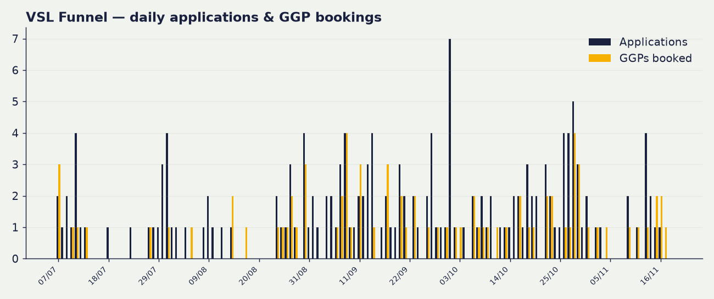

# 📈 VSL Funnel Dashboard

_Signups from Stripe (live API). Show-ups from the SBC team Tick Sheet. Spend from Meta. Updated 27 Nov 2026, 03:23 GMT, rebuilds nightly._

## 🎯 The headline — both funnels combined

| | |
|---|---|
| **Blended CPA** | **£621** |
| Total spend | **£19,236.54** |
| Total signups | **31** |
| Who signed | Abdur-rahman Sanni, Adam Luke, Adam Timpson, Alex Mc Fadden, Alexandru Mardari, Benjamin Furuberg, C Beech, C-Jay Harvey, Conor, Daniel  Steer, Georgia, Harry, Hector McFadyen, Joe Gray-Misiuk, Kirstie Hall, Lily  Colmer, Lisa, MR B CAMPBELL, Matt, Mohit, Mrs Rebecca Johnston, Musa Rahat, Phoebe Piggin, Ray Miller, Ross gibbins, Sarita Kannarath, Stephen Webb, Tarik Merrett, Tom Wain, Zeeshan Ahmed, ross lachlan |

> £19,237 spent → 31 signed = **£621 blended cost per signup.** VSL 1.0 (mass avatar) and VSL 2.0 (upgraded avatar) share the load: cheap high-volume + premium low-volume blend into one true acquisition cost.

---

## 🔀 VSL 1.0 vs 2.0 vs combined

| Metric | VSL 1.0 | VSL 2.0 | Combined |
|---|---|---|---|
| 🎯 **CPA** | **£519** | **£1,042** | **£621** |
| 🤝 Signed | 25 | 6 | **31** |
| 💷 Spent | £12,987.16 | £6,249.38 | **£19,236.54** |
| ✅ Showed up | 47 | 12 | **59** |
| 📞 GGPs booked | 99 | 19 | **118** |
| 📝 Applications | 202 | 55 | **257** |
| 👀 Opt-ins | 336 | 141 | **477** |

---

## VSL 1.0 — original avatar

> Auto-attribution: applicants matched to Calendly GGP bookings + attendance.

> Split by lead region — **UK & Ireland** vs **US & Canada** (Ireland grouped with UK). Region from timezone + phone prefix; US&CA spend from the dedicated Meta campaigns.

**Headline**

| Metric | 🇬🇧🇮🇪 UK & Ireland | 🇺🇸🇨🇦 US & Canada | Total |
|---|---|---|---|
| 💷 Spent | £12,543.25 | £443.91 | **£12,987.16** |
| 👀 Opt-ins | 289 | 41 | **336** |
| 📝 Applications | 173 | 15 | **203** |
| 📞 GGPs booked | 82 | 9 | **100** |
| ✅ Showed up | 43* | 2 | **48*** |
| 🤝 Signed | 24 | 0 | **25** |

> \* Of those booked, **3** have a call date of today or later (2 UK&I) — not yet had a chance to show up. Show rate will firm up as those calls run.

**Rates**

| Step | 🇬🇧🇮🇪 UK & Ireland | 🇺🇸🇨🇦 US & Canada | Total |
|---|---|---|---|
| Opt-in → Application | 60% | 37% | **60%** |
| Application → GGP booked | 47% | 60% | **49%** |
| GGP show rate | 52% | 22% | **48%** |
| Show → Sign | 56% | 0% | **52%** |
| Application → Sign | 14% | 0% | **12%** |

**Costs**

| Cost | 🇬🇧🇮🇪 UK & Ireland | 🇺🇸🇨🇦 US & Canada | Total |
|---|---|---|---|
| Cost per application | £73 | £30 | **£64** |
| Cost per GGP booked | £153 | £49 | **£130** |
| Cost per show-up | £292 | £222 | **£271** |
| **Cost per acquisition (CPA)** | **£523** | **—** | **£519** |

**Ad spend split**

| Band | 🇬🇧🇮🇪 UK & Ireland | 🇺🇸🇨🇦 US & Canada | Total |
|---|---|---|---|
| 🔥 Warm | £8,019.56 | £222.02 | **£8,241.58** |
| ❄️ Cold | £4,523.69 | £221.89 | **£4,745.58** |

> 🤝 Signed — Abdur-rahman Sanni, Adam Luke, Adam Timpson, Alex Mc Fadden, Alexandru Mardari, Benjamin Furuberg, C Beech, C-Jay Harvey, Daniel  Steer, Hector McFadyen, Joe Gray-Misiuk, Kirstie Hall, Lily  Colmer, MR B CAMPBELL, Mrs Rebecca Johnston, Musa Rahat, Phoebe Piggin, Ray Miller, Ross gibbins, Sarita Kannarath, Stephen Webb, Tarik Merrett, Tom Wain, Zeeshan Ahmed, ross lachlan

> ⚠️ 6 opt-ins / 15 applications couldn't be region-tagged (no timezone + unusable phone) — included in Total, shown separately below.

---

## VSL 2.0 — upgraded avatar

> Self-contained: funnel-stage ticks on the Applications (VSL 2.0) tab, backed up by Calendly/Stripe.

**Headline**

| Metric | Value |
|---|---|
| 💷 Spent | **£6,249.38** |
| 👀 Opt-ins | **141** |
| 📝 Applications | **55** |
| 📞 GGPs booked | **19** |
| ✅ Showed up | **12** |
| 🤝 Signed | **6** (Conor, Georgia, Harry, Lisa, Matt, Mohit) |

**Rates**

| Step | Rate |
|---|---|
| Opt-in → Application | 39% |
| Application → GGP booked | 35% |
| GGP show rate | 63% |
| Show → Sign | 50% |
| Application → Sign | 11% |

**Costs**

| Cost | Value |
|---|---|
| Cost per application | £114 |
| Cost per GGP booked | £329 |
| Cost per show-up | £521 |
| **Cost per acquisition (CPA)** | **£1,042** |

**Ad spend split**

- 🔥 Warm: £5,370.22
- ❄️ Cold: £879.16

---

## 📊 Trend charts (VSL 1.0)

### Daily applications & GGP bookings

### Cumulative growth

> _Applications + GGP-booked are TRUE daily series (from submission timestamps). Opt-ins have no per-day source in the Opt-ins tab, so opt-ins appear as a total only, not a daily line._

---
<!-- Auto-generated by the VSL dashboard nightly pipeline. Do not edit by hand. 27 Nov 2026, 03:23 GMT -->
