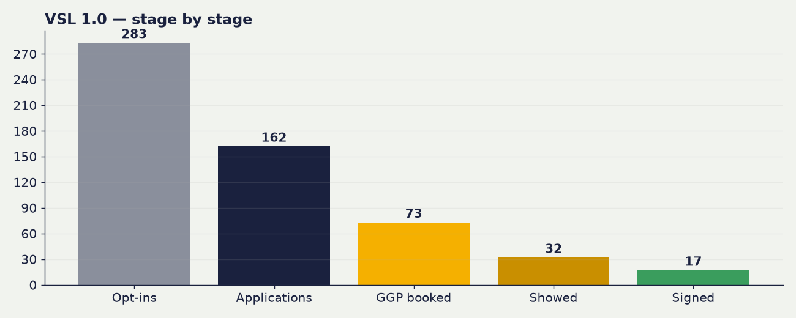
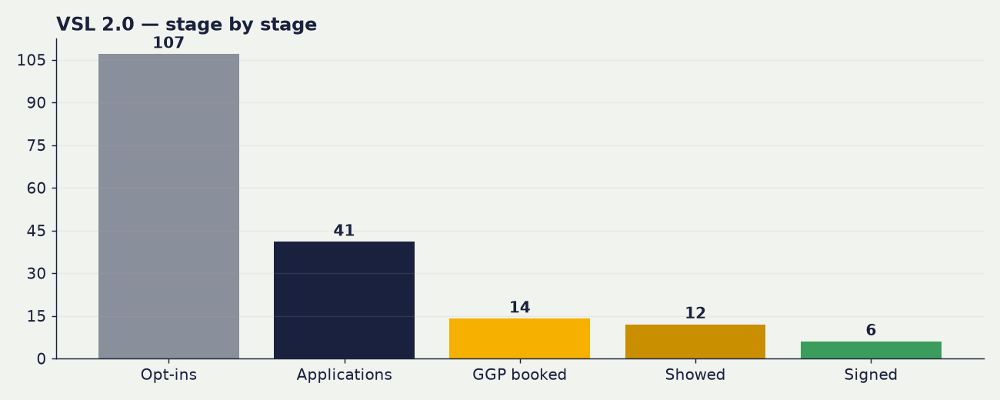
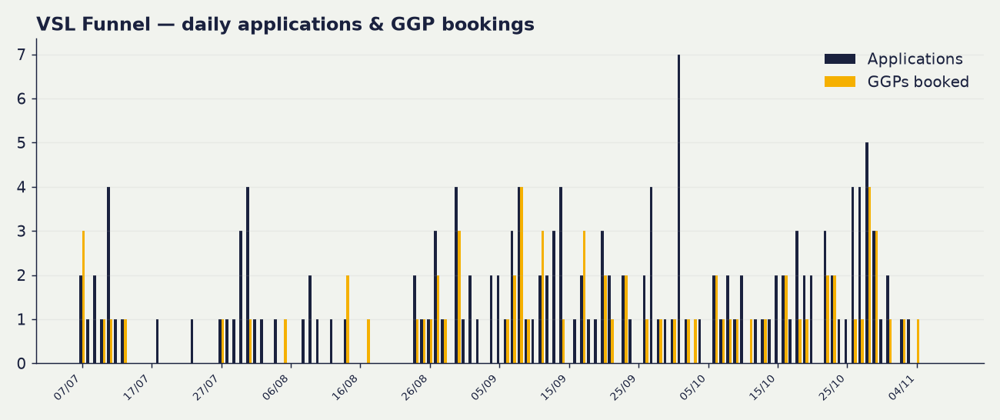
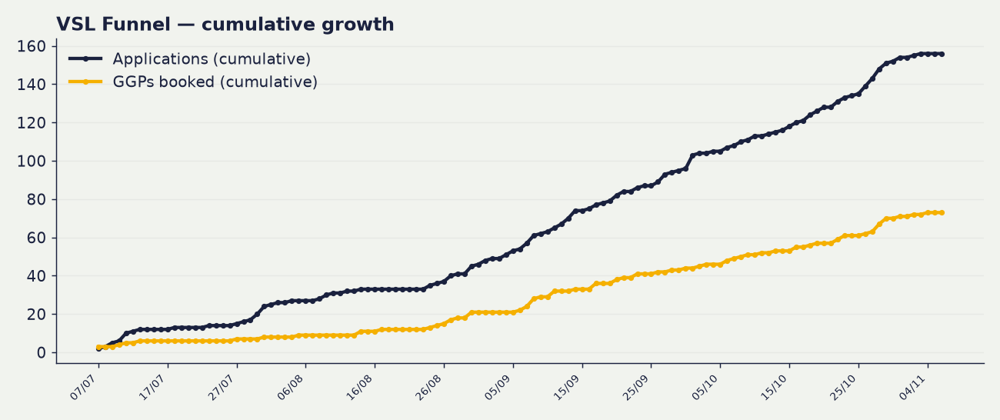

# 📈 VSL Funnel Dashboard

_Signups from Stripe (live API). Show-ups from the SBC team Tick Sheet. Spend from Meta. Updated 14 Nov 2026, 03:24 GMT, rebuilds nightly._

## 🎯 The headline — both funnels combined

| | |
|---|---|
| **Blended CPA** | **£632** |
| Total spend | **£15,792.04** |
| Total signups | **25** |
| Who signed | Adam Luke, Adam Timpson, Alex Mc Fadden, Alexandru Mardari, Benjamin Furuberg, C Beech, C-Jay Harvey, Conor, Daniel  Steer, Georgia, Harry, Joe Gray-Misiuk, Kirstie Hall, Lily  Colmer, Lisa, MR B CAMPBELL, Matt, Mohit, Musa Rahat, Ross gibbins, Stephen Webb, Tarik Merrett, Tom Wain, Zeeshan Ahmed, ross lachlan |

> £15,792 spent → 25 signed = **£632 blended cost per signup.** VSL 1.0 (mass avatar) and VSL 2.0 (upgraded avatar) share the load: cheap high-volume + premium low-volume blend into one true acquisition cost.

---

## 🔀 VSL 1.0 vs 2.0 vs combined

| Metric | VSL 1.0 | VSL 2.0 | Combined |
|---|---|---|---|
| 🎯 **CPA** | **£558** | **£864** | **£632** |
| 🤝 Signed | 19 | 6 | **25** |
| 💷 Spent | £10,610.34 | £5,181.70 | **£15,792.04** |
| ✅ Showed up | 36 | 12 | **48** |
| 📞 GGPs booked | 76 | 15 | **91** |
| 📝 Applications | 170 | 43 | **213** |
| 👀 Opt-ins | 293 | 115 | **408** |

---

## VSL 1.0 — original avatar

> Auto-attribution: applicants matched to Calendly GGP bookings + attendance.

> Split by lead region — **UK & Ireland** vs **US & Canada** (Ireland grouped with UK). Region from timezone + phone prefix; US&CA spend from the dedicated Meta campaigns.

**Headline**

| Metric | 🇬🇧🇮🇪 UK & Ireland | 🇺🇸🇨🇦 US & Canada | Total |
|---|---|---|---|
| 💷 Spent | £10,166.43 | £443.91 | **£10,610.34** |
| 👀 Opt-ins | 246 | 41 | **293** |
| 📝 Applications | 149 | 12 | **171** |
| 📞 GGPs booked | 65 | 7 | **77** |
| ✅ Showed up | 34* | 2 | **37*** |
| 🤝 Signed | 18 | 0 | **19** |

> \* Of those booked, **3** have a call date of today or later (2 UK&I) — not yet had a chance to show up. Show rate will firm up as those calls run.

**Rates**

| Step | 🇬🇧🇮🇪 UK & Ireland | 🇺🇸🇨🇦 US & Canada | Total |
|---|---|---|---|
| Opt-in → Application | 61% | 29% | **58%** |
| Application → GGP booked | 44% | 58% | **45%** |
| GGP show rate | 52% | 29% | **48%** |
| Show → Sign | 53% | 0% | **51%** |
| Application → Sign | 12% | 0% | **11%** |

**Costs**

| Cost | 🇬🇧🇮🇪 UK & Ireland | 🇺🇸🇨🇦 US & Canada | Total |
|---|---|---|---|
| Cost per application | £68 | £37 | **£62** |
| Cost per GGP booked | £156 | £63 | **£138** |
| Cost per show-up | £299 | £222 | **£287** |
| **Cost per acquisition (CPA)** | **£565** | **—** | **£558** |

**Ad spend split**

| Band | 🇬🇧🇮🇪 UK & Ireland | 🇺🇸🇨🇦 US & Canada | Total |
|---|---|---|---|
| 🔥 Warm | £6,437.93 | £222.02 | **£6,659.95** |
| ❄️ Cold | £3,728.50 | £221.89 | **£3,950.39** |

> 🤝 Signed — Adam Luke, Adam Timpson, Alex Mc Fadden, Alexandru Mardari, Benjamin Furuberg, C Beech, C-Jay Harvey, Daniel  Steer, Joe Gray-Misiuk, Kirstie Hall, Lily  Colmer, MR B CAMPBELL, Musa Rahat, Ross gibbins, Stephen Webb, Tarik Merrett, Tom Wain, Zeeshan Ahmed, ross lachlan

> ⚠️ 6 opt-ins / 10 applications couldn't be region-tagged (no timezone + unusable phone) — included in Total, shown separately below.

---

## VSL 2.0 — upgraded avatar

> Self-contained: funnel-stage ticks on the Applications (VSL 2.0) tab, backed up by Calendly/Stripe.

**Headline**

| Metric | Value |
|---|---|
| 💷 Spent | **£5,181.70** |
| 👀 Opt-ins | **115** |
| 📝 Applications | **43** |
| 📞 GGPs booked | **15** |
| ✅ Showed up | **12** |
| 🤝 Signed | **6** (Conor, Georgia, Harry, Lisa, Matt, Mohit) |

**Rates**

| Step | Rate |
|---|---|
| Opt-in → Application | 37% |
| Application → GGP booked | 35% |
| GGP show rate | 80% |
| Show → Sign | 50% |
| Application → Sign | 14% |

**Costs**

| Cost | Value |
|---|---|
| Cost per application | £121 |
| Cost per GGP booked | £345 |
| Cost per show-up | £432 |
| **Cost per acquisition (CPA)** | **£864** |

**Ad spend split**

- 🔥 Warm: £4,302.54
- ❄️ Cold: £879.16

---

## 📊 Trend charts (VSL 1.0)

### Daily applications & GGP bookings

### Cumulative growth

> _Applications + GGP-booked are TRUE daily series (from submission timestamps). Opt-ins have no per-day source in the Opt-ins tab, so opt-ins appear as a total only, not a daily line._

---
<!-- Auto-generated by the VSL dashboard nightly pipeline. Do not edit by hand. 14 Nov 2026, 03:24 GMT -->
